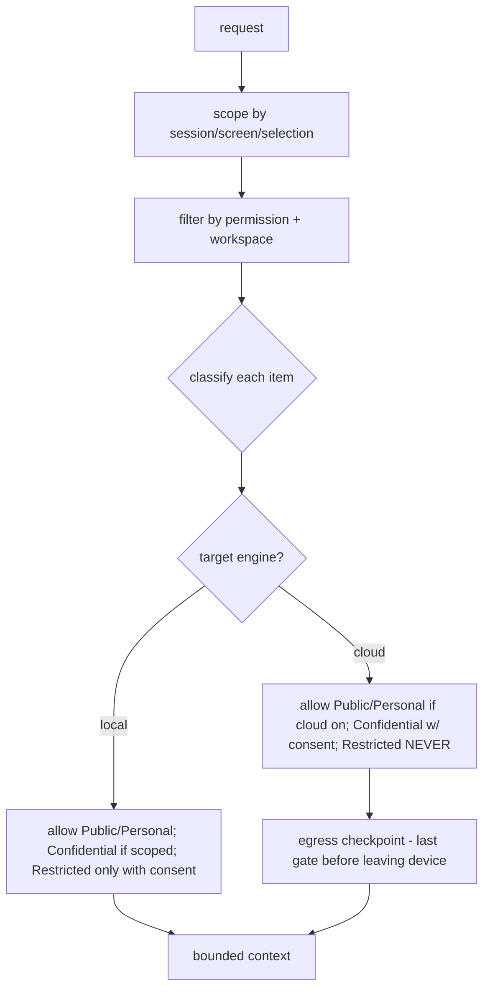

# AI Architecture

- Status: Draft (Batch 3c). Scope: interface-level contract, data flow and threat model for the P06 AI platform. No AI feature is built; implementation detail is P06. This document consumes ADR-0012 and ADR-0016 and introduces no new decision.
- Date: 2026-11-04
- Related: [../governance/ai-action-governance.md](../governance/ai-action-governance.md), [ADR-0012](../adr/0012-ai-proposal-approval-binding.md), [ADR-0016](../adr/0016-data-classification-and-egress-policy.md), [../data/data-classification.md](../data/data-classification.md), [../governance/authorization-model.md](../governance/authorization-model.md), [../assessment/legacy-repo-assessment.md](../assessment/legacy-repo-assessment.md) section 4.6

## 1. Scope and stance
AI is an untrusted actor that produces proposals; it never holds authority and never touches persistence (LF-INV-AI-001). This doc defines the component interfaces, the data that may flow where (against ADR-0016), and the threats. Component internals (prompting, model specifics) are P06.

## 2. Components (interface-level only)

| Component | Interface responsibility | Not specified here |
|---|---|---|
| AI Orchestrator | Run a session turn: build context → get proposal → validate → route to approval → execute via gateway | prompt engineering, loop tuning (P06) |
| Provider Router | Choose a provider for a request per the routing criteria (section 4) | model-specific calls |
| `AiEngine` (port) | Provider-neutral generate/stream/tools (ported from legacy) | Ollama/llama.cpp/cloud specifics |
| Model Capability Registry | Declare capability/context-length/cost per model (interface) | the actual catalog (P06) |
| Context Builder | Assemble a bounded, classified, permission-scoped context (section 3) | retrieval ranking (P06) |
| Tool Gateway | Expose domain commands as tools; validate args; execute via the command gateway | per-tool prompts |
| Proposal / Approval service | Produce proposals and version-bound approvals (ADR-0012) | UI |
| AI Session | Session + history (Confidential class) | storage detail (P06) |
| Usage / cost tracking | Record tokens/cost/provider per request | billing (later) |

No cloud adapter is specified (port only, technical-stack.md section 3).

## 3. Context Builder scoping (contract with ADR-0016)
[Decision] The Context Builder may include an item only if **all** hold:
1. **Permission**: the acting owner is authorized to read it (`AuthorizationService.check`, authorization-model.md).
2. **Workspace scope**: it belongs to the active workspace (profile isolation, LF-INV-ID-002).
3. **Session/screen scope**: it is relevant to the request (selected content, current screen, named resources) — not the whole database (reuses the legacy bounded-context principle).
4. **Classification for the target engine** (ADR-0016 egress matrix):
   - Local engine: Public/Personal always; Confidential only if the session scope permits; **Restricted denied by default** (explicit per-request consent required).
   - Cloud engine: Public/Personal only if cloud AI is enabled; Confidential needs the cloud toggle + per-request consent; **Restricted never** (LF-INV-PRIV-002).

The **egress checkpoint** is the single enforcement point before any cloud call (LF-INV-PRIV-003); a denied class is dropped, not silently sent.

## 4. Provider routing (contract with ADR-0016)
[Decision] Routing chooses a provider by: capability (does the model support the task), complexity, **privacy class of the context** (hard constraint), latency, cost, availability, user preference. Hard rules override all soft criteria:
- Restricted in the context → local only; never cloud.
- Confidential in the context → cloud only if the cloud toggle is on and per-request consent is given; else local.
- If no eligible provider exists (for example only a cloud model is available but the data forbids cloud) → the feature declines gracefully; it does not downgrade privacy (OQ-AI-2).

## 5. Action execution
AI-driven changes execute through the command gateway as the approving owner (ADR-0011/0014), with the approval bound to resource versions (ADR-0012); a changed version invalidates the approval (LF-INV-AI-002). The Tool Gateway validates arguments before policy (ai-action-governance.md).

## 6. Threat model (AI-specific; extends threat-model.md)
| Threat | Defense | Invariant |
|---|---|---|
| Prompt injection from content | Untrusted-data tagging; actions via gateway + approval | LF-INV-AI-001 |
| Data leak to cloud | Egress checkpoint; Restricted never to cloud | LF-INV-PRIV-002/003 |
| Stale proposal | Version-bound approval + revalidation | LF-INV-AI-002 |
| Privilege escalation | Same gateway + authorization as any actor | LF-INV-AI-001 |
| Over-broad context | Bounded scoping (section 3); no whole-DB context | LF-INV-PRIV-003 |
| Hallucinated references | Commands reference entities by ID; invalid id fails validation | governance-kernel |

## 7. Cross self-check against governance (required by the owner)
| Statement here | Consistent with | Verdict |
|---|---|---|
| AI never mutates persistence directly | ai-action-governance.md §1; LF-INV-AI-001 | consistent |
| Approval bound to resource version | ADR-0012; ai-action-governance.md §4 | consistent |
| Restricted never to cloud; Confidential needs consent | ADR-0016 egress matrix; data-classification.md §2 | consistent |
| Context scoped by permission + workspace | authorization-model.md §4; LF-INV-ID-002 | consistent |
| Execution via command gateway as owner | ADR-0011/0014; authorization-model.md §1 | consistent |
| No new decision introduced | this doc consumes ADR-0012/0016 only | consistent (no new ADR) |

## 8. Open questions
- OQ-AI-1: multi-command proposal approval (per-command vs batch). P06.
- OQ-AI-2: behavior when only a cloud model is available but data forbids cloud. P06 (proposal: decline).
- OQ-AI-3: retrieval/ranking approach for context. P06.

## 9. Self-check
- [x] Components are interface-level; no P06 implementation described.
- [x] Context-builder scoping and routing are precise contracts with ADR-0016.
- [x] Cross self-check table shows no contradiction with Batch-2 governance.
- [x] No cloud adapter chosen; no new ADR.
