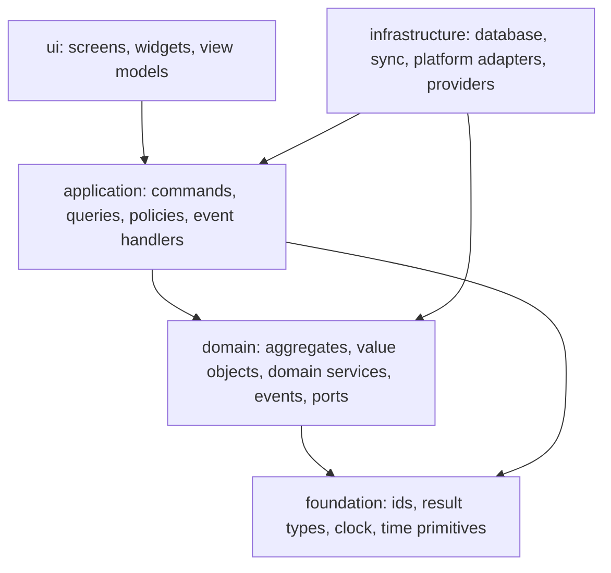

# Architecture Principles

- Status: Draft (Batch 1)
- Date: 2026-11-04
- Related: [bounded-contexts.md](bounded-contexts.md), [context-map.md](context-map.md), [../adr/0004-modular-monolith-and-bounded-contexts.md](../adr/0004-modular-monolith-and-bounded-contexts.md)

Fitness function IDs (`FF-*`) are provisional names; the batch on invariants and fitness functions defines them with owners and CI stages. [Proposal]

## 1. Principles

| ID | Principle | Rule | Enforcement idea (provisional) |
|---|---|---|---|
| AP-01 | Domain-oriented modular monolith | One deployable app; modules are bounded contexts with explicit public contracts. No microservices. | FF-MOD-01 package boundary check |
| AP-02 | Dependency direction | `ui -> application -> domain`; `infrastructure -> application/domain` (implements ports). Domain depends on nothing but `foundation`. | FF-DEP-01 import rules |
| AP-03 | Pure domain | Domain code does not import Flutter, Drift, Supabase, platform plugins or HTTP. | FF-DOM-01 import scan |
| AP-04 | Own your data | A context's tables are accessed only by that context's infrastructure. Other contexts use its published contract (query port, command or event). | FF-DB-01 table ownership map |
| AP-05 | Single mutation path | Every state change enters through an application command carrying actor, workspace, operation ID and expected version. UI, AI, sync and background jobs use the same path. | FF-GOV-01 no repository write outside handlers |
| AP-06 | Governed authority | Authorization and policy are evaluated by the application layer before the domain method runs. UI only presents; database triggers do not hold business rules. | FF-GOV-02 |
| AP-07 | AI and external providers are not authorities | AI produces proposals; providers (health, dictionary, calendar) produce data. Neither writes domain state directly. | FF-AI-01 |
| AP-08 | Local-first persistence | Local database is the working store; sync is a transport of commands/operations, not a place for business semantics. | Sync design batch |
| AP-09 | Stable identity and tombstones | Entities have client-generated UUIDs that never change. Deletes are tombstones until retention allows purge. | Invariant tests |
| AP-10 | Explicit time semantics | Date-only values and instants are different types. Local calendar date, timezone and DST rules are explicit. | Property tests |
| AP-11 | Private by default | New data is Personal and private. Sharing and cloud-AI use require explicit action and classification. | Data classification batch |
| AP-12 | One state-management approach | The app uses one pattern for UI state, decided in the technical-stack batch. Screen state is never the source of truth for domain data. | Review + lint |
| AP-13 | Right-sized abstractions | An abstraction exists only for a stated use case or an already-planned second implementation. | Review |
| AP-14 | Everything testable without UI | Domain and application layers run under plain `dart test`. | CI |
| AP-15 | Decisions are recorded | A decision with trade-offs gets an ADR. | Review |

## 2. Layering

- [Proposal] `infrastructure` depends on `domain` only to implement ports and map to storage. `application` never imports `infrastructure`; composition happens at the app root.
- [Proposal] Cross-context calls go `application -> other context's published contract`. They never go `domain -> other domain`.

## 3. Cross-cutting capabilities (not bounded contexts)

These are technical foundations. They contain no business rules of any one context.

| Capability | Responsibility | Notes |
|---|---|---|
| Governance Kernel | Command gateway, authorization check, policy evaluation hook, idempotency, optimistic concurrency, audit record, domain-event publication, outbox write | Minimal in MVP; the sync-facing parts (outbox) are designed now, filled in P04. |
| Persistence | Drift database, migrations, transactions, per-context repositories | Table ownership is documented. |
| Sync | Outbox/inbox, replication transport | Post-MVP (P04). |
| Platform adapters | Notifications, file access, background execution, TTS, health platform clients | Behind ports; contain no domain decisions. |
| Time kernel | Local date, instant, timezone, DST resolution, schedule and recurrence primitives | See bounded-contexts.md, Planning & Scheduling. |

## 4. What this means for a coding agent

- [Proposal] Each phase's definition of done includes: architecture checks pass, new commands have idempotency and audit behavior as required, invariants touched have tests.
- [Proposal] The agent must not add a dependency across packages that is not listed in the package dependency table (repository-structure batch).

## 5. Checklist

- [x] Every principle states a rule and a way to check it.
- [x] No principle requires a technology not yet decided (backend, state management).
- [x] Cross-cutting capabilities are separated from bounded contexts.
