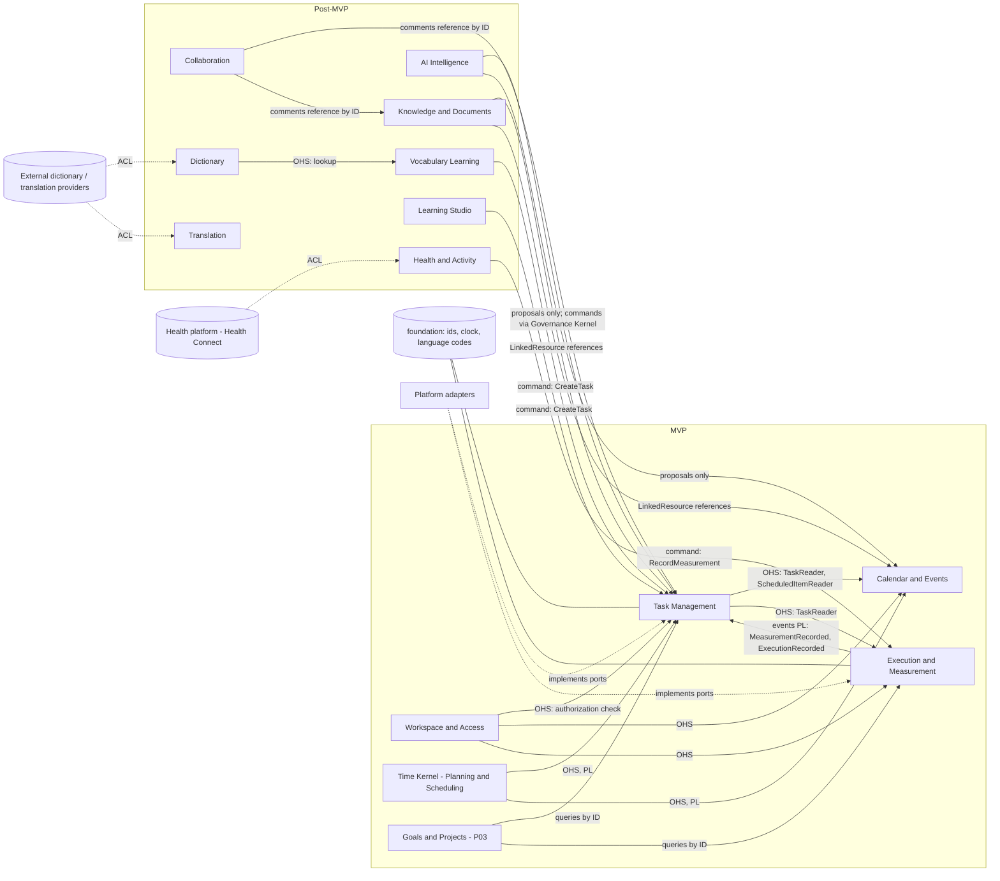

# Context Map (Preliminary)

- Status: Draft (Batch 1)
- Date: 2026-11-04
- Related: [bounded-contexts.md](bounded-contexts.md)

Relationship vocabulary: **U/D** upstream/downstream, **PL** published language, **OHS** open host service (query/command port), **ACL** anti-corruption layer, **CF** conformist, **SK** shared kernel.

## 1. Map

## 2. Relationship table

| Upstream | Downstream | Type | Contract | MVP |
|---|---|---|---|---|
| Time Kernel | Task Management, Calendar and Events | OHS + PL | `ScheduleSpec`, `RecurrenceRule`, `OccurrenceWindowQuery`, `OverlapQuery` (pure functions/value objects) | Yes |
| Execution and Measurement | Task Management | PL via events | `MeasurementRecorded`, `MeasurementCorrected`, `ExecutionRecorded` | Yes |
| Task Management | Calendar and Events | OHS | `ScheduledItemReader` (read-only occurrences of scheduled tasks) | Yes |
| Task Management | Execution and Measurement | OHS | `TaskReader.exists(taskId)` / `TaskSummary` (read-only) | Yes |
| Workspace and Access | all contexts | OHS | `AuthorizationService.check(actor, action, resourceRef)` invoked by the Governance Kernel | Yes (single local-owner policy in MVP; profile data isolation) |
| Task Management, Execution and Measurement | Goals and Projects | OHS (read-only) | `TaskReader`, measurement summaries; progress is derived, never written back | Yes (P03) |
| Backend auth provider | Workspace and Access | ACL | `AuthGateway` port (sign-in, session, sign-out); provider per ADR-0003 | Yes |
| Health and Activity | Execution and Measurement | command with PL | `RecordMeasurement(source, provenance, ...)` | No (P08) |
| Learning Studio, Vocabulary Learning | Task Management | command | `CreateTask`, `UpdateTask` | No |
| AI Intelligence | Task Management, Calendar and Events, others | proposal then command | `AiProposal` validated and executed through Governance Kernel | No (P06) |
| Dictionary | Vocabulary Learning | OHS | `LookupEntry`, `LexicalEntryRef` | No |
| Knowledge and Documents | Task Management, Calendar and Events | reference | `LinkedResource(type, id)` | No |
| External providers | Dictionary, Translation, Health | ACL | Provider ports and mappers | No |

## 3. Shared Kernel decision

[Proposal] The only shared code between contexts is the `foundation` package: typed IDs, clock, result type, language codes, and basic local-date/instant primitives. Time **rules** are not part of the kernel; they are in the Time Kernel context so they can be versioned and tested as a unit. A larger shared kernel would need an ADR.

## 4. Anti-corruption layers (planned)

| ACL | Protects | Notes |
|---|---|---|
| Health platform ACL | Health and Activity from Android Health Connect types, units and permission model | Provider data is normalized into evidence with provenance |
| Dictionary provider ACL | Dictionary from provider-specific schemas and licenses | Source and license metadata kept on every entry |
| Translation provider ACL | Translation from vendor APIs | Routing by privacy level |
| Calendar integration ACL (post-MVP) | Calendar and Events from Google/Outlook event shapes | The legacy `CalendarEvent` is Google-shaped; do not copy that shape into the domain |
| Backend ACL | Application from the chosen backend (Supabase, Firebase) | ADR-0003 |

## 5. Consistency checks

- [x] No arrow from a post-MVP context into an MVP context requires a change to the MVP context; they use existing commands, events or readers.
- [x] No cycle between context packages (the Execution to Task event path and the Task to Execution reader path use different contracts: events versus ID/summary read ports; both are listed so the check is explicit). [Open] If a stricter acyclic rule is wanted, `TaskReader` can move to `foundation` as an `exists(taskId)` port. Decision in the domain batch.
- [x] AI, Health and Learning never write another context's tables.
