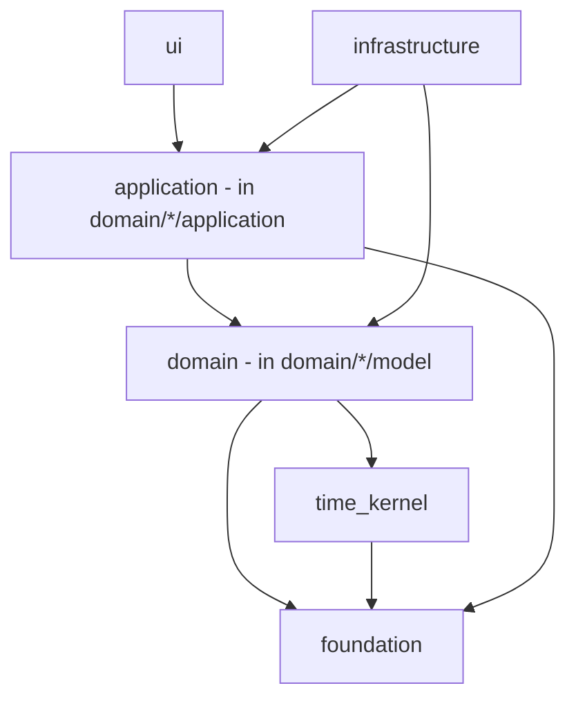

# Repository Structure

- Status: Draft (Batch 3c)
- Date: 2026-11-04
- Related: [../architecture/architecture-principles.md](../architecture/architecture-principles.md), [ADR-0004](../adr/0004-modular-monolith-and-bounded-contexts.md), [ADR-0013](../adr/0013-time-kernel-packaging.md), [technical-stack.md](technical-stack.md)

## 1. Monorepo layout
```text
lifeflow/
├── apps/
│   └── lifeflow_app/              # the Flutter app (composition root, UI shell)
├── packages/
│   ├── foundation/                # IDs, LocalDate/Instant/ZonedWallClock, Result, language codes, ActorRef
│   ├── time_kernel/               # schedule/recurrence/occurrence/DST rules (ADR-0013), pure Dart
│   ├── domain/                    # per-context domain models + application commands/queries/ports
│   │   ├── task/ planning/ calendar/ execution/ goals/ workspace/   # MVP
│   │   └── (document/ health/ dictionary/ vocabulary/ ai/ ...)       # later phases
│   ├── infrastructure/            # Drift DB, repositories, outbox/sync, platform adapters, provider adapters
│   ├── ui/                        # widgets, view models (Riverpod), router (go_router), adaptive shells
│   └── testing/                   # shared test utilities, fakes
├── backend/                       # (P04) backend config, kept out of the app; backend-neutral until ADR-0003
├── docs/
└── tools/                         # scripts, license scan, fitness-function runners
```
[Proposal] Whether each context is its own package or a folder inside `domain/` is confirmed in P01; the dependency rules below hold either way.

## 2. Dependency direction

Rules (from AP-02/03/04): `domain` depends only on `foundation` and `time_kernel`; `application` depends on `domain` + `foundation`; `infrastructure` implements ports from `application`/`domain`; `ui` depends on `application` (via view models), never on `infrastructure` or another context's internals; composition happens in `apps/lifeflow_app`.

## 3. Package dependency table
| Package | May depend on | Must NOT depend on |
|---|---|---|
| foundation | (nothing app-specific) | Flutter, Drift, any context |
| time_kernel | foundation, `timezone` | Flutter, Drift, any context |
| domain/* | foundation, time_kernel | Flutter, Drift, Supabase, another context's internals |
| application (domain/*/application) | its domain, foundation, time_kernel, other contexts' **published ports** | infrastructure, Flutter widgets |
| infrastructure | application + domain ports, Drift, platform/provider SDKs | ui |
| ui | application (view models), foundation | infrastructure, domain internals, Drift |
| apps/lifeflow_app | everything (composition root only) | — |

## 4. Port placement
| Port | Defined in | Implemented in |
|---|---|---|
| Repository ports (per context) | domain/* | infrastructure |
| `AuthGateway`, `RemoteGateway` | application (workspace/sync) | infrastructure (backend-neutral; impl per ADR-0003) |
| `FileViewer`, `TtsPort`, `SpeechPort` | application | infrastructure (adapters; libraries per spikes) |
| `AiEngine`, provider ports | domain/ai (P06) | infrastructure (Ollama/llama.cpp/cloud) |
| `SelectionAdapter` | ui (contract) + application | ui per renderer |

Backend is not hard-wired: `apps/lifeflow_app` wires a concrete `AuthGateway`/`RemoteGateway` at startup; everything else sees only the port (ADR-0003).

## 5. Fitness functions (IDs defined here; Batch 4 implements/runs them)
[Decision] These IDs are canonical now so Batch 4 does not redefine them:

| ID | Rule | How checked (proposal) | Severity |
|---|---|---|---|
| FF-ARCH-01 | `domain/*` and `time_kernel` and `foundation` import no Flutter, Drift, Supabase, or platform SDK | import scan over package sources | critical |
| FF-ARCH-02 | No context's code imports another context's internal (non-published) symbols; only published ports/types | import scan + allowlist of published APIs | critical |
| FF-ARCH-03 | No repository write (save/delete) is called outside a command handler | call-graph / lint rule over application layer | critical |
| FF-ARCH-04 | `ui` does not import `infrastructure` or Drift | import scan | high |
| FF-ARCH-05 | No cyclic dependency between packages/contexts | package graph check | high |
| FF-ARCH-06 | Every mutation command handler writes the atomic set in one transaction (aggregate+audit+outbox+event+dedupe) | targeted test/inspection (ties to LF-INV-GOV-003) | critical |
| FF-ARCH-07 | No dependency with AGPL or unknown license in the resolved dependency set | license scan (ADR-0018) | critical |
| FF-ARCH-08 | No egress path includes a Restricted-class item toward cloud AI | test over the Context Builder (ties to LF-INV-PRIV-002) | critical |

(FF-GOV-01/02 referenced earlier map to FF-ARCH-03 and the authorize-before-domain check; Batch 4 reconciles the final naming.)

## 6. Legacy port mapping
| Legacy asset | LifeFlow package |
|---|---|
| AI core/policy/tool layering (`lib/ai`) | domain/ai + infrastructure (P06) |
| `wall_clock_resolver`, `RepeatRule` logic | time_kernel |
| progress calculators | domain/goals, domain/execution |
| reminder scheduler ports | application + infrastructure |

## 7. Build and test boundaries
- Each package is independently testable; `foundation`, `time_kernel` and `domain/*` run under plain `dart test` (AP-14).
- CI (Batch 4) runs per-package tests + the fitness functions (section 5).

## 8. Open questions
- OQ-REPO-1: one package per context vs folders under `domain/` (confirm P01).
- OQ-REPO-2: final fitness-function naming reconciliation with Batch 4.

## 9. Self-check
- [x] Dependency table is acyclic; domain depends only on foundation/time_kernel.
- [x] Ports placed; backend not hard-wired (backend-neutral).
- [x] Fitness-function IDs (FF-ARCH-01..08) defined here for Batch 4.
