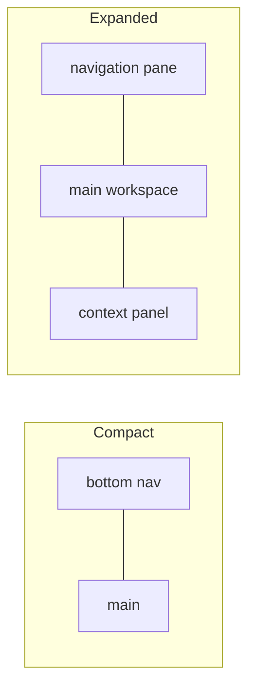

# UI/UX Architecture

- Status: Draft (Batch 3c)
- Date: 2026-11-04
- Related: [ADR-0019](../adr/0019-ui-state-management-and-navigation.md), [repository-structure.md](repository-structure.md), [../domains/dictionary-translation.md](../domains/dictionary-translation.md), [../domains/execution-measurement.md](../domains/execution-measurement.md), [../product/requirements.md](../product/requirements.md) (NFR-UX, NFR-ACC)

## 1. Principles
- [Decision] Layout is driven by **available window size** (breakpoints), not device type. The same build adapts from a phone window to a maximized desktop window (FR-CAL-02, NFR-UX-01).
- [Decision] Business logic stays out of widgets; UI state is never the domain source of truth (AP-12, ADR-0019). Widgets read view models (Riverpod providers) that call application queries/commands.

## 2. Breakpoints and layout
[Proposal] Three layout classes by width (exact values confirmed in P01 with benchmarks):
- Compact (phone): single pane, bottom navigation.
- Medium (small tablet / narrow desktop window): navigation rail + one main pane, context as a sheet/overlay.
- Expanded (tablet landscape / desktop): navigation pane + main workspace + optional context panel, resizable.

## 3. Navigation
- [Decision] Declarative routes via go_router (ADR-0019). One route table serves all layout classes; the shell differs (tabs vs rail vs pane) but routes are shared.
- Mobile primary destinations (proposal): Home, Tasks, Calendar, Documents (P05), AI (P06). Dictionary is quick-access from content screens and also a standalone page (brief 13).
- Tablet/desktop: navigation pane + main + context panel; panes resizable where it helps.

## 4. Cross-cutting interactions
| Interaction | Mechanism | Cross-platform? | Reference |
|---|---|---|---|
| Dictionary popup from selected text | `SelectionAdapter` → lookup/translate → popup | Capability is cross-platform; the adapter per renderer is platform/renderer-specific | dictionary-translation.md §4 |
| Focus session overlay persists across navigation | A global overlay bound to the focus session state, above the router shell (FR-FOCUS-06) | Cross-platform | execution-measurement.md |
| AI context panel | A pane/sheet that shows the bounded AI context for the current screen | Cross-platform shell; content P06 | ai-architecture.md |
| Vocabulary save from selection | Selection → SaveVocabulary command | Cross-platform | vocabulary-learning.md |
[Decision] Which interactions need platform-specific implementation is called out per row (the selection adapter differs by renderer; overlays and panels are cross-platform Flutter).

## 5. State-management boundary
- [Decision] Each screen has a view model (Riverpod provider) that depends on application queries/commands, not on repositories or the database directly, and not on another screen's state. Domain mutations go through commands (ADR-0011); the UI never writes a repository.
- [Decision] Long-lived cross-screen state (for example the running focus session) lives in an application-scoped provider, not in a screen, so it survives navigation (fixes the legacy pattern where timer state was a global BLoC; here it is an application service surfaced via a provider).

## 6. Accessibility posture
- [Proposal] Semantics labels on interactive elements, sufficient color contrast, keyboard navigation and focus order on Windows, scalable text. These are requirements NFR-ACC-01.
- [Decision] Full WCAG conformance is **not claimed**; full validation requires manual testing with assistive technologies and expert review. The MVP targets the basics above and documents the gap.

## 7. Platform-specific vs cross-platform (summary)
- Cross-platform: layout, routing, view models, overlays, panels, most widgets.
- Platform-specific: text-selection adapters per renderer (PDF/WebView/native), notifications/background behavior (technical-stack candidates + S-05), file dialogs, and any desktop-only window management.

## 8. Implementation status (P01)
- **T6a (2026-11-06):** `packages/ui` implements the adaptive shell (compact = `NavigationBar`, medium = labelled `NavigationRail`, expanded = extended rail) from one go_router `StatefulShellRoute`; Tasks and Profiles screens; the non-silent storage banner (ADR-0021, SR-01a) as a live region. `ui` sees only `application` ports and read models (`TaskQueries`, `TaskService`, `ProfileService`, `StorageNotice`), enforced by **FF-ARCH-04** in CI. `apps/lifeflow_app` is the composition root; the DB lives in the app-private support directory, not Documents.
- Breakpoints adopted provisionally at **600 / 840 px** (Material 3 window size classes); OQ-UI-1 stays open for benchmarking.
- Deferred to T6b: real sign-in (`SupabaseAuthGateway`) and the guest→bind UI; Android encrypted executor.

## 9. Open questions
- OQ-UI-1: exact breakpoint widths (benchmark in P01). Provisional 600/840 in use.
- OQ-UI-2: desktop window state (multi-window?) — out of MVP unless needed.

## 10. Self-check
- [x] Adaptive by window size, not device type.
- [x] Business logic out of widgets; UI not the domain source of truth (AP-12).
- [x] Focus overlay persistence and selection adapter covered.
- [x] WCAG caveat stated (manual validation needed).
