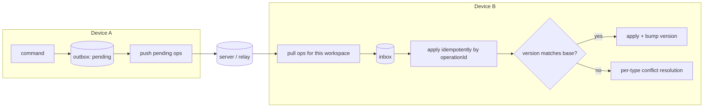

# Sync Protocol (P04 design, shaped now)

- Status: Draft (Batch 3a). The sync engine is built in P04; this document is the contract the MVP's outbox and identity model must satisfy so sync can be added without redesign.
- Date: 2026-11-04
- Related: [../governance/governance-kernel.md](../governance/governance-kernel.md), [ADR-0014](../adr/0014-transactional-outbox-and-atomic-side-effects.md), [ADR-0009](../adr/0009-identifier-and-versioning-strategy.md), [ADR-0015](../adr/0015-per-type-conflict-resolution.md), [data-architecture.md](data-architecture.md)

## 1. Purpose
Move and reconcile changes across a user's devices (and, with sharing, across members) without losing data and without a global Last-Write-Wins. Sync is a transport and reconciliation mechanism; it does not decide business semantics (AP-08). Backend-neutral: the design does not assume Supabase (ADR-0003 open), though RLS alignment is noted where relevant.

## 2. Building blocks (already defined)
- **Operation identity**: `operationId` (UUID v7) per command (ADR-0009, governance-kernel.md).
- **Outbox**: each committed mutation wrote a `SyncOperation` row in the same transaction (ADR-0014, LF-INV-OUTBOX-001), carrying `baseVersion`, `operationType`, payload/tombstone.
- **Per-entity version**: optimistic concurrency token (LF-INV-VER-001).
- **Tombstones**: deletes are tombstones, carried in the outbox (LF-INV-SYNC-004).

## 3. Outbox / inbox flow

- **Push**: send `pending` outbox ops; mark `sent`, then `acked` on confirmation.
- **Pull**: fetch ops for the workspace since a cursor; place in an inbox; apply in order.
- **Idempotent apply**: applying an op whose `operationId` was already applied is a no-op (dedupe table, LF-INV-GOV-003). This makes retries and replays safe.
- **Ordering**: ops are applied per entity in `baseVersion` order; across entities, causal order is preserved by applying in the server-assigned sequence. [Open] OQ-SYNC-1: exact ordering guarantee (per-entity vs global) — proposal: per-entity total order, best-effort cross-entity, decided in P04.

## 4. Conflict detection
A conflict is: an incoming op has `baseVersion = v`, but the local entity is already at version `> v` from a different op. Detection uses the version, not timestamps. On conflict, resolution is **per data type** (ADR-0015), never a single global rule.

## 5. Per-type conflict resolution (ADR-0015)
[Decision] Each data category has its own strategy:

| Data type | Strategy | Rationale |
|---|---|---|
| Task metadata (title, tags, priority, list) | Field-level merge; last-writer-wins per field by version then timestamp tiebreak | Independent fields rarely truly conflict; per-field merge avoids clobbering |
| Task status / completion | Deterministic precedence (done > inProgress > todo) with an audit note; never silently downgrade a completion | Losing a completion is worse than a spurious done; surfaced in audit |
| Schedule / RecurrenceRule | Whole-value last-writer-wins by version, with a conflict record the user can review | A schedule is one coherent value; merging halves is unsafe |
| OccurrenceException | Union by `(seriesId, originalDate)`; same date → last-writer-wins | Exceptions are keyed; union preserves most intent |
| ExecutionRecord | Append-only; never overwrite; duplicates deduped by `operationId` | History must be preserved (LF-INV-EXEC-001) |
| Measurement | Append-only with provenance; corrections are new rows; dedupe by `(source, origin-id)` | Preserve history and multi-source evidence (LF-INV-HEALTH-004) |
| Vocabulary learning progress (P07) | Merge by taking the most-advanced review state; never regress a learned item | Learning progress must not be overwritten (brief) |
| Document revisions (P05) | Keep both as sibling revisions; surface a conflict; no silent content loss (CRDT only if justified later) | No silent content loss (brief); CRDT is out of scope now (AP-10) |
| Workspace membership / permissions | **Server-authoritative**; client ops that disagree are rejected | Authorization cannot be decided by a client (RLS) |
| LocalProfile | Not synced | Local-only |

[Decision] No category uses global Last-Write-Wins. Where LWW-by-field is used (task metadata), it is field-scoped and version-ordered with a timestamp tiebreak, and a conflict record is kept for user-visible categories (schedule, completion, documents).

## 6. Tombstones and deletion
- A delete is a tombstone op; applying it sets the local tombstone, it does not hard-delete (LF-INV-SYNC-004).
- Delete-vs-edit conflict (UC-19): a tombstone meeting a concurrent edit surfaces a conflict record; default proposal is tombstone wins for trash semantics but the edit is recoverable from history. [Open] OQ-SYNC-2, P04.
- Purge (hard delete) only happens locally after a retention window and is itself a replicated op so other devices purge too.

## 7. Retry and failure
- Push/pull use bounded exponential backoff; offline simply defers (NFR-OFF-01 unaffected).
- Partial batch failure: per-op status, continue with the rest (do not block the queue on one bad op), surface persistent failures.

## 8. Schema evolution
- Ops carry an `entityType` and the schema version they were produced under; the receiver applies a forward migration to the op payload if needed (same migration ladder as the local schema, VS-04). [Open] OQ-SYNC-3: how far back op compatibility is guaranteed. P04.

## 9. RLS alignment (if Supabase, ADR-0003)
If the backend is Supabase, every synced table has an RLS policy mirroring the authorization model so a device cannot read or write another tenant's rows even by crafting ops (VS-06, VS-07). The `supabase test db` suite asserts allow/deny per role (VS-08). Membership/permission ops are server-authoritative (section 5). This paragraph is conditional on ADR-0003.

## 10. Invariants
- LF-INV-SYNC-001 (idempotent apply by operationId), LF-INV-SYNC-002 (conflict detected by version, not time), LF-INV-SYNC-003 (no global LWW; per-type resolution), LF-INV-SYNC-004 (tombstone propagation), plus reliance on LF-INV-OUTBOX-001/002 and LF-INV-GOV-003 from the kernel.

## 11. Open questions
- OQ-SYNC-1 ordering guarantee; OQ-SYNC-2 delete-vs-edit default; OQ-SYNC-3 op schema compatibility window. All P04.

## 12. Self-check
- [x] Built on the ADR-0014 outbox; no new identity mechanism.
- [x] Per-type conflict table; no global LWW (LF-INV-SYNC-003).
- [x] Membership/permissions are server-authoritative.
- [x] Backend-neutral; RLS paragraph is conditional on ADR-0003.
