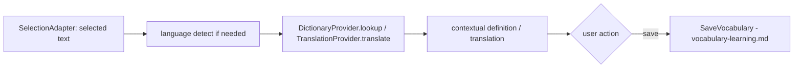

# Domain: Dictionary and Translation

- Status: Draft (Batch 3b)
- Date: 2026-11-04
- Classification: Supporting. Phase: P07. In MVP: no. Two separate capabilities sharing only language primitives.
- Related: [vocabulary-learning.md](vocabulary-learning.md), [../data/data-classification.md](../data/data-classification.md), [../architecture/domain-model.md](../architecture/domain-model.md)

## 1. Purpose
Look up words/phrases (Dictionary) and translate text (Translation). These are **separate domains with their own models and logic**; they share only language primitives from `foundation` (language codes, script). Both read provider data through a provider port and an anti-corruption layer; neither depends on a specific provider or on scraping.

## 2. Dictionary

### 2.1 Aggregates / value objects
- `LexicalEntry` (provider-sourced, cached): `headword`, `language`, `senses: List<Sense>`, `pronunciations: List<Pronunciation>`, `partOfSpeech`, `examples`, `source` (provider + license ref), `fetchedAt`. Read-mostly cache of provider data.
- `Sense`: definition, domain/register, examples, synonyms/antonyms refs.
- `Pronunciation`: IPA, optional audio ref, variant (UK/US) — audio only if the source license permits (spike S-10).
- `DictionaryPackage` (offline): a downloadable dataset for a language pair, with `source`, `license`, `version`.

### 2.2 Provider port + ACL
- `DictionaryProvider` port: `lookup(headword, lang) → LexicalEntry?`. Implementations (online API, offline package) sit behind an ACL that maps provider schemas into `LexicalEntry` and attaches `source`/`license` metadata.
- [Decision] Provider-sourced data is distinguished from user- or AI-generated content. **AI-generated definitions are not authoritative dictionary data** by default; they are shown as AI content, not stored as `LexicalEntry` provider data (brief 3.7).

### 2.3 Sources and licensing (Open — spike S-10)
[Open] No dictionary source is chosen in this batch. Candidate sources to evaluate in spike S-10 (batch 5): Wiktionary/Kaikki extracts, Free Dictionary API, WordNet, CC-CEDICT, and others. For each, S-10 must record: license, redistribution rights, attribution requirement, commercial-use restriction, offline-caching conditions, API rate limits, data freshness, and pronunciation/audio licensing. No design here depends on scraping a site against its terms; the provider-port + ACL structure means the source is swappable and the licensing decision does not change the domain model.

License criteria the chosen source(s) must satisfy (recorded now, evaluated in S-10):
- redistribution permitted for the intended offline-package use,
- attribution requirement expressible in-app,
- commercial-use terms compatible with the app's distribution,
- offline caching allowed.

## 3. Translation

### 3.1 Aggregates / value objects
- `TranslationRequest`: `sourceText`, `sourceLang?` (may be auto-detected), `targetLang`, `scope {word, sentence, paragraph, document}`, `createdAt`.
- `TranslationResult`: `targetText`, `provider`, `confidence?`, `alternatives?`, `createdAt`. Translation history is user data (Personal; a translated private document stays Confidential — classification follows the source text).

### 3.2 Provider port + ACL + routing
- `TranslationProvider` port: `translate(request) → TranslationResult`. Local and cloud implementations behind an ACL.
- [Decision] Provider routing obeys the egress matrix (ADR-0016): Confidential source text may go to cloud translation only with the cloud toggle + per-request consent; Restricted never. Local/offline translation is preferred when the data class forbids cloud.

### 3.3 Separation from Dictionary
[Decision] Dictionary and Translation have distinct models and logic (brief 3.7). They may share `foundation` language primitives and, where a source license allows, some lexical data, but Translation is not implemented as "dictionary lookup per word".

## 4. Cross-renderer selection adapter
[Decision] Text selection for "look up / translate the selected text" is modeled as a renderer-agnostic `SelectionAdapter` contract, not tied to one widget:
- `SelectionAdapter.currentSelection() → SelectedText(text, language?, sourceRef)`.
- Implementations: Flutter `SelectableText`/rich-text, PDF viewer, WebView, native view — each maps its own selection mechanism to the contract (brief 3.7 notes these differ).
- A lookup/translate action consumes a `SelectedText`, not a widget. This keeps Dictionary/Translation independent of the renderer.

## 5. Invariants
| ID | Statement | Enforcement |
|---|---|---|
| LF-INV-DICT-001 | Lexical identity (headword+language+sense) is separate from contextual meaning captured by the user | Dictionary vs Vocabulary models |
| LF-INV-DICT-002 | Source and license provenance are preserved on cached lexical data | ACL attaches source/license |
| LF-INV-DICT-003 | AI-generated definitions are not stored as authoritative provider dictionary data | lookup stores provider data only |
| LF-INV-DICT-004 | Translation routing obeys the egress matrix | provider router checks classification |

## 6. Open questions
- OQ-DICT-1: chosen dictionary/translation sources and licenses — spike S-10 (batch 5).
- OQ-DICT-2: language-detection approach (on-device vs provider). P07.
- OQ-DICT-3: pronunciation audio source and license. S-10.

## 7. Self-check
- [x] Dictionary and Translation are separate models; share only language primitives.
- [x] Provider port + ACL; no source chosen; no scraping-based design.
- [x] Selection adapter is renderer-agnostic.
- [x] Egress matrix governs cloud translation.
