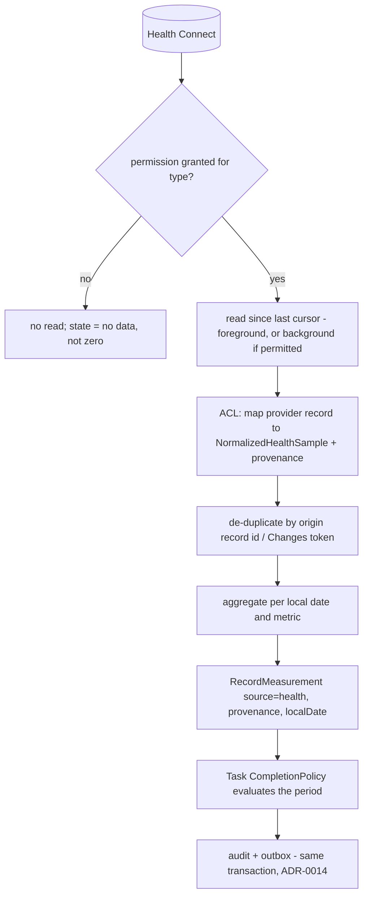

# Domain: Health and Activity Integration

- Status: Draft (Batch 3b)
- Date: 2026-11-04
- Classification: Supporting. Phase: P08. In MVP: no. Platform: Android Health Connect only (HealthKit/iOS is a future extension point, see [deferred-contexts.md](deferred-contexts.md)).
- Related: [execution-measurement.md](execution-measurement.md), [../data/data-classification.md](../data/data-classification.md), [ADR-0016](../adr/0016-data-classification-and-egress-policy.md), [../research/verified-sources.md](../research/verified-sources.md) VS-11..VS-15, OQ-V1/OQ-V9

## 1. Purpose
Read permitted activity/health metrics (steps first) from Android Health Connect, normalize and de-duplicate them, and publish them as **evidence** to Execution and Measurement via one contract. Health never owns Task lifecycle and never decides completion. It validates that the Batch-2 `RecordMeasurement` seam and the 3a egress matrix are usable end to end.

## 2. Classification and non-negotiables
- [Decision] Health and activity data is **Restricted** (ADR-0016): never sent to cloud AI, never shared implicitly, cloud sync opt-in per category only, not used in analytics.
- [Decision] Health publishes **only** `Measurement`s via `RecordMeasurement` (execution-measurement.md). It writes no Task, FocusSession or completion state (LF-INV-AI-equivalent for providers: a provider is a data source, not an authority — authorization-model.md).
- [Decision] **Missing data is not zero** (LF-INV-HEALTH-002). A day with no reading is `no data` until the period closes under the Task `CompletionPolicy`.
- [Decision] Revocation is **not** retroactive deletion and **not** zero (LF-INV-HEALTH-003, new): stored measurements remain with provenance marking a now-revoked source; the user may delete them explicitly.

## 3. Aggregates and value objects
- **`HealthConnection`** (root): the app's connection to Health Connect — granted permissions (per data type), background-read permission state, last-read cursor/Changes-token per data type, and status (connected, revoked, unavailable). Boundary: the connection and its per-type read state.
- `NormalizedHealthSample` (value object, transient): a provider record mapped into LifeFlow units with provenance, before it becomes a `Measurement`. Not stored as its own aggregate; it is the ACL's output that feeds `RecordMeasurement`.
- Health does not own a stored measurement aggregate; the stored evidence is a `Measurement` owned by Execution and Measurement.

## 4. Permission model (VS-11, VS-12)
- Health Connect is an Android API; part of the framework on Android 14+, an installable app on Android 13 and lower (VS-11). Windows has no Health Connect (OQ-V1); on Windows the context is inert (no provider), and any health evidence there would arrive only via sync from an Android device (P04) — not designed in P08.
- Permissions are per data type, requested at runtime, and revocable at any time; the app re-checks before each use (VS-12). Background read requires a separate permission (VS-13).

## 5. Ingestion flow

- Foreground reads always; background reads only with the Background Read permission; the app also checks on resume and periodically (VS-13).
- Changes tokens are per data type; on token expiry, re-read from the last timestamp or last 30 days and de-dup by identifiers (VS-14). De-duplication happens **in the ACL before** `RecordMeasurement`, so Execution and Measurement receives already-deduped evidence.

## 6. Metric table (steps is the MVP-of-P08 metric; others follow the same shape)
| Metric | Unit | Source | Aggregation | Time boundary | Update freq | Freshness | Missing-data | Duplicate detection | Correction |
|---|---|---|---|---|---|---|---|---|---|
| Steps | count | Health Connect `StepsRecord` | sum per local date | local calendar day (ADR-0010) | on foreground/resume + periodic; background if permitted | may lag; late data expected | `no data`, not 0 | by origin record id + Changes token (VS-14) | late/corrected records update the day; history kept via Measurement corrections |
| (later) distance, active minutes, exercise, sleep, heart rate | per Health Connect type | Health Connect | per-metric (sum/max/latest) | local day/session | same | same | `no data` | same | same |

[Decision] MVP-of-P08 reads **steps only**, aggregates per day, evaluates the measurable habit. No custom fitness algorithm (brief 3.8).

## 7. Validation of Batch-2 / 3a contracts (the reason Health is written first)
- `RecordMeasurement` (execution-measurement.md) already carries `source`, `provenance{deviceId, recordedAt, origin}`, `value`, `unit`, `localDate`, and a dedupe hook by `(source, origin-id)`. [Verified against the Batch-2 doc] This is sufficient for Health: `source=health`, `origin=` Health Connect record id, dedupe by origin id.
- **One gap found and recorded (not silently worked around):** Health needs to record the **read window / Changes-token state** so re-reads after token expiry are correct. This belongs to `HealthConnection` (this context), not to `Measurement`, so no change to the Execution and Measurement committed contract is required. Recorded as OQ-HEALTH-1 rather than editing the Batch-2 contract.
- The egress matrix (ADR-0016) already classifies Health as Restricted; no new egress rule needed. [Verified] contract usable.

## 8. Invariants
| ID | Statement | Enforcement |
|---|---|---|
| LF-INV-HEALTH-001 | Health access is permission-scoped and re-checked before each use | `HealthConnection` + Health Connect API |
| LF-INV-HEALTH-002 | Missing data is not zero | Execution period evaluation reads only existing Measurements |
| LF-INV-HEALTH-003 | Revocation is not retroactive deletion and not zero | revocation handler keeps data with provenance |
| LF-INV-HEALTH-004 | Provenance (origin id, device, read time) is preserved | ACL requires provenance on every sample |
| LF-INV-HEALTH-005 | Duplicate protection: the same source activity is not counted twice | ACL dedup by origin id / Changes token |
| LF-INV-HEALTH-006 | Health evidence cannot bypass Task completion policy | Health only calls `RecordMeasurement`; Task decides completion |

## 9. Domain events
Health emits no domain events of its own; its effect is the `MeasurementRecorded` event emitted by Execution and Measurement when `RecordMeasurement` commits. (Catalog: domain-model.md section 5.)

## 10. Open questions
- OQ-HEALTH-1: where the per-type read cursor / Changes-token lives (proposal: on `HealthConnection`); confirm in P08.
- OQ-HEALTH-2: background read cadence and battery trade-off; P08 spike S-13.
- OQ-V1 (Windows has no Health Connect), OQ-V9 (confirm Health Connect data-type/aggregation API URLs) stand.

## 11. Self-check
- [x] Android Health Connect only; HealthKit is a one-line extension point elsewhere.
- [x] Every metric row complete; steps is the MVP-of-P08 metric.
- [x] Health writes only measurements; missing≠zero; revocation handled.
- [x] Batch-2 `RecordMeasurement` seam validated; the one gap is recorded as OQ-HEALTH-1, not a silent workaround.
