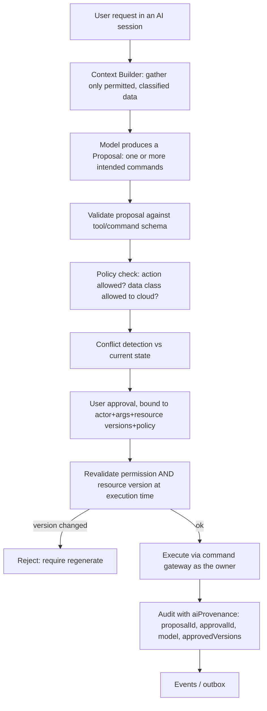

# AI Action Governance

- Status: Draft (Batch 2). Scope: governs how AI will act when the AI Platform (P06) arrives. No AI feature is built in the MVP.
- Date: 2026-11-04
- Related: [ADR-0012](../adr/0012-ai-proposal-approval-binding.md), [governance-kernel.md](governance-kernel.md), [authorization-model.md](authorization-model.md), [../assessment/legacy-repo-assessment.md](../assessment/legacy-repo-assessment.md) section 4.6

## 1. Principle
AI is an untrusted actor. It may read permitted context and produce proposals, but it never holds authority and never touches persistence directly. Every AI-driven change executes through the same command gateway and authorization as any other actor (LF-INV-AI-001). This refactors the legacy AI layer, which was well-layered but bound approvals only to arguments with no resource version (the gap this document closes).

## 2. Lifecycle

## 3. Context building (privacy scope)
- The Context Builder includes only data the owner may see and that is permitted to leave the device if a cloud model is used (authorization-model.md section 6). It never dumps the database (reuses the legacy bounded-context principle).
- Free text from user content (note bodies, descriptions) is tagged `{"untrusted": true, ...}` so the model treats it as data, not instructions (ported legacy pattern).

## 4. Proposal and approval
- A **Proposal** is a list of intended commands with concrete arguments and the resource versions they were computed against.
- **Approval** is bound to: the acting owner, the exact command arguments, the `resourceRef → Version` map, and the policy context at approval time (ADR-0012). An approval is not reusable for a different proposal or a changed resource.
- At execution, the gateway revalidates authorization and compares each `expectedVersion` to the current version. Any mismatch rejects the action and requires regeneration (LF-INV-AI-002). This closes the legacy stale-approval gap.

## 5. Threat handling (covers the brief's AI threats)
| Threat | Defense |
|---|---|
| Prompt injection (malicious text in a note/doc) | Untrusted-data tagging + standing system rule; destructive/write actions still require approval and go through policy (enforced in code, not just the prompt). Ported from the legacy `prompt_injection_test` design. |
| Tool misuse / invalid arguments | Schema validation before policy; arguments validated like any command payload. |
| Stale proposal | Version binding + execution-time revalidation (section 4). |
| Privilege escalation | AI uses the same gateway + authorization; no direct repository or SQL access (LF-INV-AI-001). |
| Data leakage to cloud | Context Builder enforces data classification before context leaves the device; cloud use is an authorized, classified action. |
| Hallucinated references | Commands reference entities by ID; a non-existent ID fails validation/NotFound, never creates phantom state. |

## 6. Determinism boundary
[Decision] Features that must be correct do not depend on AI: scheduling, recurrence, completion, conflict detection, permissions and sync are deterministic (principle P4). AI assists (proposes plans, explains, summarizes) but the deterministic core is the source of truth.

## 7. Provider routing (P06, from the brief)
Routing considers capability, complexity, privacy level, latency, cost, availability and user preference. A cloud provider is only eligible when the data classification permits and the user allows it. The legacy gateway seam supports this; no cloud adapter exists yet (assessment section 4.6).

## 8. Invariants
- LF-INV-AI-001 (no authorization bypass, no direct persistence), LF-INV-AI-002 (approval bound to resource version), plus LF-INV-GOV-001/002 (shared pipeline).

## 9. Open questions
- OQ-AI-1: how multi-command proposals approve (all-or-nothing vs per-command). Proposal: per-command approval with a batch convenience; each still version-checked. P06.
- OQ-AI-2: offline behavior when the only permitted model is cloud. P06.

## 10. Self-check
- [x] Every AI threat in the brief has a defense.
- [x] Approval binding includes resource versions (fixes the legacy gap).
- [x] AI executes only through the command gateway.
