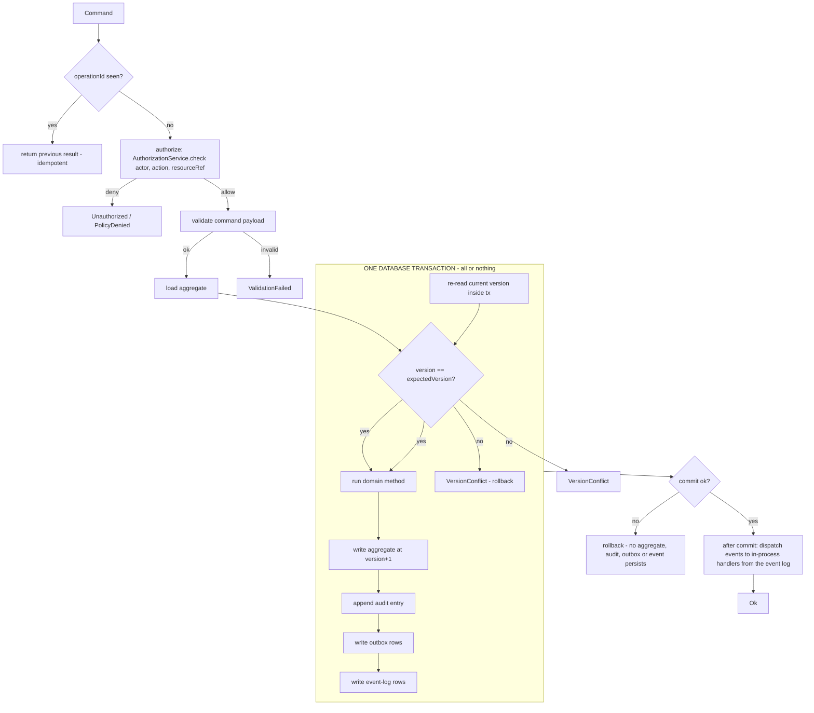

# Governance Kernel

- Status: Draft (Batch 2)
- Date: 2026-11-04
- Classification: cross-cutting application foundation (not a bounded context).
- Related: [ADR-0011](../adr/0011-command-gateway-single-mutation-path.md), [authorization-model.md](authorization-model.md), [audit-and-provenance.md](audit-and-provenance.md), [../architecture/architecture-principles.md](../architecture/architecture-principles.md) AP-05/AP-06

## 1. Purpose
Every state change in LifeFlow enters through one path so that UI, AI, background jobs and (P04) sync cannot bypass authorization, audit, idempotency or concurrency control. This is the enforcement home of LF-INV-GOV-001 and LF-INV-GOV-002.

## 2. Command envelope
```
Command {
  operationId: UUID v7        // idempotency key, client-generated
  actor: ActorRef             // owner | aiAssistant | provider | sync
  workspaceId: WorkspaceId
  type: string                // e.g. "CreateTask"
  payload: typed args
  expectedVersion: Version?   // required for updates; null for creates
  issuedAt: Instant
}
```
`CommandResult` is `Ok(entityId, newVersion, events)` or a typed failure: `Unauthorized`, `ValidationFailed`, `VersionConflict(currentVersion)`, `DuplicateOperation(previousResult)`, `NotFound`, `PolicyDenied(reason)`.

## 3. Pipeline



Steps (Decision):
1. **Idempotency (pre-transaction read).** If `operationId` is already in the dedupe table, return the stored result; do not re-run.
2. **Authorize.** `AuthorizationService.check`. Deny stops here (LF-INV-GOV-002). AI and providers are ordinary actors, never exempt.
3. **Validate.** Payload shape and preconditions that do not need the aggregate.
4. **Open one transaction.** Everything from here to commit is inside a single database transaction (ACID). See section 3.1 for the exact atomic set and the version semantics.
5. **Commit or rollback.** On any failure before or during commit, the whole transaction rolls back: no aggregate change, no audit, no outbox, no event-log row persists (LF-INV-OUTBOX-001, LF-INV-OUTBOX-002). On success, the dedupe table is updated with the result in the same transaction (LF-INV-GOV-003).
6. **Dispatch events after commit.** In-process handlers (for example Goals recomputing progress) are invoked **after** the transaction commits, reading from the durable event log, not from volatile memory (section 3.2). A handler failure never rolls back the committed command; it retries from the event log.

### 3.1 Atomicity and version semantics (Decision)

Inside the single transaction, in order:
1. **Re-read the current aggregate version inside the transaction** (not the value read earlier in step 2/3). Optimistic concurrency is checked here, under transaction isolation, so a concurrent writer cannot slip between the check and the write.
2. If `expectedVersion` is supplied and does not equal the current version, **abort the transaction** and return `VersionConflict(currentVersion)`. Nothing is written.
3. If it matches (or the command is a create), run the domain method, then write, all in this transaction:
   - the aggregate at **`version + 1`** (the increment happens here, inside the transaction, only after the match — never before),
   - the **audit entry**,
   - the **outbox rows**,
   - the **event-log rows**,
   - the **dedupe record** for `operationId` with the result summary.
4. **Commit.** All five writes and the aggregate change commit together or not at all. There is no state in which the aggregate changed but the audit, outbox or event log is missing, and none in which a duplicate `operationId` could be applied twice (the dedupe record commits atomically with the change).

Version increment therefore has exactly these semantics: read-current-version-in-tx → compare to `expectedVersion` → if equal, write `version+1` and all side records → commit; if not equal, rollback and return conflict. The pre-transaction load in step 2/3 is only a fast-fail optimization; the authoritative check is the in-transaction re-read.

### 3.2 Event delivery (resolves OQ-GOV-1)

[Decision] Events are **persisted inside the transaction** (the event log is part of the atomic set) and **dispatched to handlers after commit** (the transactional-outbox pattern). This gives both properties the owner required:
- No lost-event window on crash: because the event log is written in the same transaction as the mutation, a crash between "mutation committed" and "handler ran" cannot lose the event — on restart, undispatched event-log rows are dispatched. There is never a committed mutation whose event was never recorded.
- No handler failure rolling back the command: because dispatch is after commit, a failing handler retries from the event log and does not undo the user's change.

The outbox (for sync) and the event log (for in-process handlers) are both written in the transaction; they differ only in who drains them (sync transport vs in-process dispatcher). Both may be the same physical table with a `channel` column, decided in the data batch.

## 4. Transaction boundary
[Decision] One command mutates one aggregate instance. Cross-aggregate effects happen by emitting an event that a handler turns into another command (eventual within the same device session, still each atomic). Exception: a small, explicitly listed set of "compose" operations (for example create-task-with-initial-schedule) may write a root and its directly owned value objects in one transaction because they are one aggregate.

## 5. Idempotency
- Key: `operationId` (UUID v7, client-generated). Scope: per workspace.
- The dedupe record is written **inside the command transaction** (section 3.1), so a crash cannot leave a committed mutation whose `operationId` is not yet recorded as applied; the same command can never be applied twice (LF-INV-GOV-003).
- Guarantee: applying the same command twice yields one state change and the same result. Essential for retry and (P04) sync replay (LF-INV-SYNC-004 relies on this).

## 6. Optimistic concurrency
- Every update supplies `expectedVersion`.
- The authoritative check and the `version+1` write both happen **inside the transaction** after an in-transaction re-read (section 3.1, LF-INV-VER-001); the pre-transaction load is only a fast-fail.
- Conflict returns `VersionConflict(currentVersion)` so the caller (UI or AI) can refetch and retry. AI approvals specifically must revalidate version (LF-INV-AI-002, see ai-action-governance.md).

## 7. Outbox (P04 contract, shaped now)
Each successful mutation writes one or more outbox rows so sync can replay them later. Shape (from the brief, adopted as the contract):
```
SyncOperation {
  operationId: UUID v7
  entityId: UUID
  entityType: string
  workspaceId: WorkspaceId
  actorId: ActorRef
  operationType: {create, update, delete}
  baseVersion: Version      // version before this change
  payload: change set or tombstone
  createdAt: Instant
  status: {pending, sent, acked}
}
```
[Decision] The outbox table exists from P01 (written on every mutation) even though nothing drains it until P04. This avoids a migration and guarantees no change is unrecorded. Draining, ordering and conflict resolution are the sync batch.

[Decision] The outbox row is written **inside the same transaction** as the mutation (section 3.1), never after commit. Writing the outbox after commit would create a crash window in which a mutation is durable but its sync operation was never recorded — a silent lost update at P04. This is forbidden by LF-INV-OUTBOX-001. See [ADR-0014](../adr/0014-transactional-outbox-and-atomic-side-effects.md).

## 8. MVP-minimal vs later
| Capability | MVP | Later |
|---|---|---|
| Atomic set (aggregate + audit + outbox + event log + dedupe) in one transaction | Yes (P01) | — |
| In-transaction version re-read and increment | Yes (P01) | — |
| Event-log write in tx; dispatch after commit | Yes (P01) | — |
| Outbox write in tx | Yes (P01), not drained | Drained in P04 |
| Authorization | Single-owner policy | Membership/roles/RLS (P04) |
| Policy engine hook | Present but trivial (owner-allow) | Real policies (sharing, AI limits) |

## 9. Invariants enforced here

| ID | Statement | Why |
|---|---|---|
| LF-INV-GOV-001 | All state changes go through the command gateway | single mutation path |
| LF-INV-GOV-002 | Authorization is checked before the domain method runs | no unauthorized mutation |
| LF-INV-GOV-003 | A command's aggregate change, audit entry, outbox rows, event-log rows and dedupe record are written in one transaction, atomically | no partial state; no apply-twice |
| LF-INV-OUTBOX-001 | An outbox row for a mutation exists if and only if the mutation committed (same transaction) | no lost sync operation on crash |
| LF-INV-OUTBOX-002 | An event-log row for a mutation exists if and only if the mutation committed (same transaction) | no lost in-process event on crash |
| LF-INV-AUDIT-001 | An audit entry for a mutation exists if and only if the mutation committed (same transaction) | no change without provenance |
| LF-INV-VER-001 | Version is re-read and compared inside the transaction, and incremented only on a match, before commit | no lost update under concurrency |
| LF-INV-SYNC-004 | Tombstones are recorded (and carried in the outbox) | delete propagates |

All of LF-INV-GOV-003 and the OUTBOX/AUDIT/VER invariants are formalized in [ADR-0014](../adr/0014-transactional-outbox-and-atomic-side-effects.md).

## 10. Open questions
- OQ-GOV-1: **Resolved.** Events are persisted in the transaction and dispatched after commit (transactional outbox); see section 3.2 and ADR-0014.
- OQ-GOV-2: dedupe-table and event-log retention / compaction. Data batch.
- OQ-GOV-3: whether outbox and event log are one physical table with a `channel` column or two tables. Data batch.

## 11. Self-check
- [x] Every failure mode has a typed result.
- [x] AI and providers go through the same pipeline (no bypass).
- [x] Outbox shape carries baseVersion and tombstone for P04.
- [x] Aggregate, audit, outbox, event log and dedupe commit atomically in one transaction (LF-INV-GOV-003, OUTBOX-001/002, AUDIT-001).
- [x] Version is re-read and incremented inside the transaction (LF-INV-VER-001); the pre-transaction read is only a fast-fail.
- [x] On any failure the whole transaction rolls back; no partial outbox/event/audit.
- [x] Events persist in the transaction, dispatch after commit (OQ-GOV-1 resolved).
