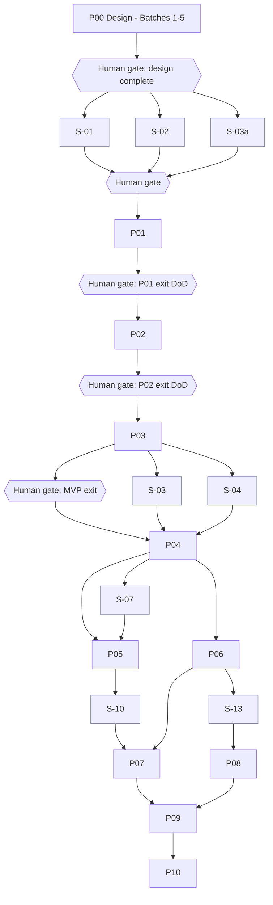

# Dependency Map

- Status: Draft (Batch 5)
- Date: 2026-11-04
- Related: [master-roadmap.md](master-roadmap.md), [phase-breakdown.md](phase-breakdown.md), [../spikes/spike-plan.md](../spikes/spike-plan.md)

Shows phase→phase and spike→phase dependencies, and where the single delivery lane (one developer + one coding agent) forces sequencing. **Human review gates** are explicit: after each spike and at each phase exit.

## 1. Graph

## 2. Hard sequences (one lane)
- P01 → P02 → P03 are strictly sequential: Planning needs the Task/Time foundation; Execution needs both. [Decision]
- P04 (Sync) requires a stable P01–P03 domain (the outbox exists from P01, but draining/conflict needs the full domain to reconcile).
- P05 (Documents), P06 (AI), P07 (Dictionary/Vocabulary), P08 (Health), P09 (Learning) each depend on P04's command/sync maturity and on their own spike.
- AI (P06) depends on the data-classification/egress contract (3a) and governance (Batch 2), both already designed; its spike-free start is the orchestrator wiring.

## 3. What can overlap (limited)
[Assumption] With one lane, true parallelism is small. The realistic overlaps:
- Running a spike while writing tests or docs for the dependent phase (the agent drafts tests while the human reviews the spike).
- Writing a later phase's work-package notes while an earlier phase is in review.
There is **no** second independent implementation lane; the human is the single reviewer/decision-maker, which serializes exits.

## 4. Spike → phase blocking
| Spike | Blocks | Gate before phase work |
|---|---|---|
| S-01, S-02 | P01 (and FTS/migrations) | yes |
| S-03a | P01 sign-in | yes |
| S-05 | reminders in P01/P02 | yes |
| S-03, S-04 | P04 | yes |
| S-07 | P05 | yes |
| S-08, S-09 | P05 viewers | yes (viewer feature only) |
| S-10 | P07 | yes |
| S-12 | reading/pronunciation (P05/P07) | yes (feature only) |
| S-13 | P08 | yes |
| S-14 | iOS (post-MVP) | n/a |

## 5. Consistency
- [x] No phase depends on a later phase.
- [x] MVP-blocking spikes (S-01/S-02/S-03a) precede P01 dependent work.
- [x] The graph matches the context-map dependencies and the DoD anchors (Batch 4).

## 6. Self-check
- [x] Human review gates shown after each spike and at each phase exit.
- [x] Single-lane sequencing stated; overlaps are limited and explicit.
