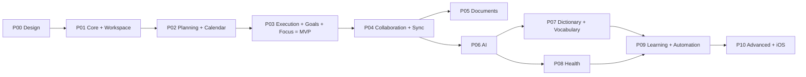

# Master Roadmap

- Status: Draft (Batch 5)
- Date: 2026-11-04
- Entry point for implementation planning. Detail: [phase-breakdown.md](phase-breakdown.md); dependencies: [dependency-map.md](dependency-map.md); effort: [effort-estimation.md](effort-estimation.md); risks: [risk-register.md](risk-register.md); spikes: [../spikes/spike-plan.md](../spikes/spike-plan.md).

Timeline is **ordinal** (phases and milestones in order), not calendar dates: one developer + one coding agent has high variance, and calendar dates would imply false precision. Person-day ranges appear only on the critical path (effort-estimation.md).

## 1. Phase sequence

## 2. The MVP
[Decision] MVP = **P01 → P02 → P03**, strictly sequential (one lane). At MVP exit the user has: guest-first offline personal task app on Windows + Android, with scheduling/recurrence/calendar, focus with crash recovery, measurable habits, and goals/projects — all local, encrypted, with the governance spine (atomic commands, audit, outbox ready for sync) and optional sign-in. No sync, documents, AI, dictionary or health yet.

## 3. Critical path
P00 → (S-01, S-02, S-03a) → P01 → P02 → P03. This is the whole MVP; there is no parallel branch that shortens it in a single lane. After the MVP, P04 is the gateway to everything else (P05/P06 depend on it), so P04 is the next critical node. See effort-estimation.md for person-day ranges on this path.

## 4. Milestones (ordinal)
- D: design complete (P00 exit = this corpus).
- MVP-blocking spikes pass (S-01, S-02, S-03a).
- P01 exit (DoD §P01) — the governance spine and offline task core proven by GS-06/07/12/19/20/22.
- P02 exit (DoD §P02) — recurrence/DST proven by GS-03/04.
- P03 exit (DoD §P03) — **MVP** proven by GS-01/13/21.
- P04 exit — sync proven by GS-08/14/17.
- Then P05/P06, P07/P08, P09, P10 per the graph.

## 5. Exit-gate summary
Each phase exits only on its Definition of Done ([../testing/definition-of-done.md](../testing/definition-of-done.md)): build + static fitness functions green, phase tests pass, the phase's invariants verified in the matrix, new dependencies license-cleared (ADR-0018), ADRs updated. A **Human review gate** follows every phase exit and every spike (dependency-map.md).

## 6. What is deferred and why (summary)
- Sync/Collaboration (P04): highest-risk; needs a stable domain first (ADR-0005).
- Documents/AI/Dictionary/Health/Learning (P05–P09): each attaches via contracts already in the MVP (LinkedResource, RecordMeasurement, CreateTask, command gateway); none requires redesigning the core.
- iOS/HealthKit/CRDT (P10): only on validated need (AP-13).

## 7. Self-check
- [x] Phase order matches dependency-map and context-map.
- [x] MVP boundary (end P03) and the critical path are explicit.
- [x] Timeline is ordinal; person-day ranges live in effort-estimation.
- [x] Exit gates reference the DoD, not restated.
