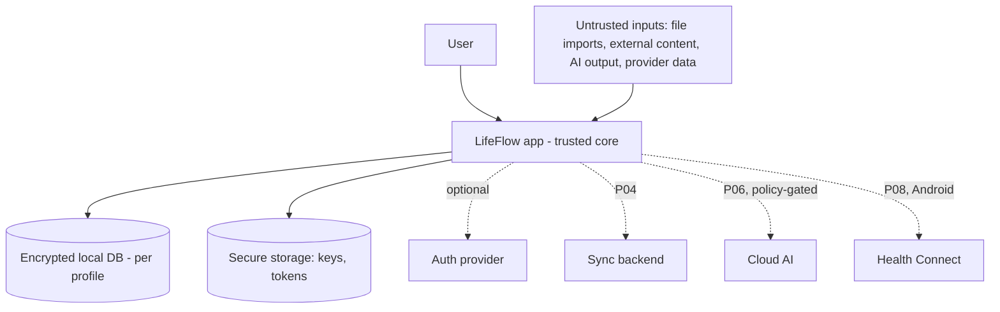

# Threat Model

- Status: Draft (Batch 3a)
- Date: 2026-11-04
- Related: [privacy-model.md](privacy-model.md), [security-requirements.md](security-requirements.md), [../data/data-classification.md](../data/data-classification.md), [../governance/authorization-model.md](../governance/authorization-model.md)

Scope: the MVP (guest-first local app on Windows and Android, optional auth, local encrypted store) plus the designed-but-not-built boundaries (sync P04, cloud AI P06, health P08) so later batches inherit a consistent model. Method: assets, trust boundaries, STRIDE-style threats, mitigations mapped to invariants.

## 1. Assets
| Asset | Class | Why it matters |
|---|---|---|
| User content (tasks, events, goals, focus) | Personal | Core value; loss or corruption is the worst outcome |
| Private documents, AI chat | Confidential | Privacy harm if leaked |
| Health/activity data | Restricted | Sensitive; regulated expectations |
| Auth tokens, DB encryption key | Restricted | Compromise exposes everything |
| Audit/provenance log | Personal | Integrity needed for trust |

## 2. Trust boundaries

The app core is trusted; everything crossing a dotted boundary is treated as untrusted on the way in and policy-gated on the way out (data-classification egress matrix).

## 3. Threats and mitigations (STRIDE)
| # | Threat | Category | Mitigation | Invariant |
|---|---|---|---|---|
| T1 | Another app or user reads the local DB file | Information disclosure | Whole-file encryption (SQLite3MultipleCiphers); key in secure storage | LF-INV-SEC-001 |
| T2 | Cross-profile data leak on a shared device | Information disclosure | One encrypted DB file per profile; structural isolation | LF-INV-ID-002 |
| T3 | Health or secrets sent to cloud AI | Information disclosure | Default-deny egress; Restricted never to cloud AI | LF-INV-PRIV-002 |
| T4 | Prompt injection makes AI perform a destructive action | Elevation of privilege / tampering | Untrusted-data tagging; AI goes through the command gateway + authorization; destructive actions need approval | LF-INV-AI-001 |
| T5 | Stale AI approval applied after data changed | Tampering | Approval bound to resource version; revalidated at execution | LF-INV-AI-002 |
| T6 | Lost update when two devices edit concurrently | Tampering / data loss | In-transaction version check; per-type conflict resolution | LF-INV-VER-001, LF-INV-SYNC-003 |
| T7 | Lost sync op or event on crash | Data loss | Transactional outbox/event log (same tx as mutation) | LF-INV-OUTBOX-001/002 |
| T8 | A client grants itself access to another tenant's data | Elevation of privilege | Membership/permissions server-authoritative; RLS (if Supabase) as defense in depth | authorization-model; VS-06/07 |
| T9 | Malicious import file corrupts or injects data | Tampering | Import validates schema, version and checksum; untrusted until validated; failures are atomic | NFR-DATA-01 |
| T10 | Auth token theft from logs or storage | Information disclosure | Tokens only in secure storage; never logged, exported, synced or in AI context | LF-INV-SEC-001 |
| T11 | Revoked health permission misread as zero | Integrity | No-data is not zero; provenance preserved; revocation handled | LF-INV-HEALTH-002/004 |
| T12 | Offline unavailability blocks access | Availability | Local-first; auth failure never blocks local data | LF-INV-SEC-002, NFR-OFF-01 |
| T13 | Spoofed external calendar/health/provider data | Spoofing | Provider data enters via an ACL, is never authoritative over domain state | authorization-model |
| T14 | Repudiation of a change | Repudiation | Audit entry in the same transaction records actor/version/outcome | LF-INV-AUDIT-001 |

## 4. Out of scope (stated)
- A fully compromised OS or rooted device with the app unlocked (whole-file encryption does not protect a running, unlocked app). [Assumption] acceptable for the target audience.
- Server-side infrastructure hardening (P04+), covered when the backend is chosen (ADR-0003).
- Supply-chain attacks on dependencies: partly mitigated by pinning versions (brief guidance); full SCA is post-MVP.

## 5. Self-check
- [x] Every threat maps to a mitigation and, where applicable, an invariant.
- [x] Guest/account, sync, AI, health boundaries are included.
- [x] Out-of-scope items are stated, not silently ignored.
