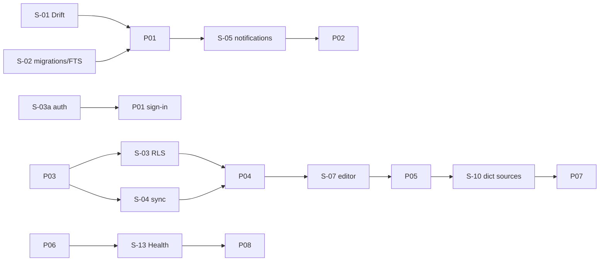

# Spike Plan

- Status: Draft (Batch 5)
- Date: 2026-11-04
- Related: [../roadmap/dependency-map.md](../roadmap/dependency-map.md), [../research/verified-sources.md](../research/verified-sources.md), [../roadmap/effort-estimation.md](../roadmap/effort-estimation.md)

Spikes are small throwaway proofs of concept, not features. Each has a **time-box in person-days**; the rule is: **if the time-box ends without a conclusion, record the result as Open and escalate to a Human decision — do not extend the spike into a feature.** Every spike ends with a Human review gate before the dependent work starts. Person-day ranges reflect one developer + one coding agent (one lane); they are ranges, not commitments.

## Legend
- **MVP-blocking**: must conclude before the dependent MVP work.
- Time-box: person-days (pd), the cap before escalate-as-Open.

## Spikes

| ID | Question | MVP-blocking? | Time-box | Blocks | Success criteria | Failure → |
|---|---|---|---|---|---|---|
| S-01 | Does Flutter + Drift (`NativeDatabase`) run cleanly on Windows and Android with bundled sqlite3 3.x? | Yes | 1–2 pd | P01 | app opens a Drift DB on both platforms; CRUD + transaction work | reconsider local store; Open + escalate |
| S-02 | Do Drift guided migrations work, and is **FTS5 available under the encrypted (SQLite3MultipleCiphers) build** (OQ-V10)? | Yes | 1–3 pd | P01 (FTS), P02 (migrations) | `PRAGMA compile_options` shows ENABLE_FTS5 on the encrypted build; a migration test passes | FTS5 absent → fallback LIKE search for MVP (documented), Open + escalate |
| S-03a | Can the chosen auth provider do email + one social login, cached offline session, and a Windows desktop flow with PKCE S256 (not plain)? | Yes (before sign-in work) | 2–4 pd | P01 sign-in | sign-in works on Windows + Android; session survives offline restart; no token in logs | pick another provider or defer sign-in UX; Open + escalate |
| S-03 | Does Supabase RLS enforce multi-tenant isolation for shared workspaces with acceptable complexity/perf? | No (P04) | 2–4 pd | P04 | a membership-scoped RLS policy passes `supabase test db` allow/deny | choose a different backend/approach; needs external input |
| S-04 | Can the outbox/inbox sync reconcile deliberate offline conflicts per-type without data loss? | No (P04) | 3–5 pd | P04 | two-replica harness: conflicts resolve per ADR-0015; idempotent replay; no loss | redesign conflict handling; Open + escalate |
| S-05 | Local notifications + any needed background behavior on Windows and Android? | No (P01/P02) | 1–3 pd | reminders | reminders fire on both platforms; Windows behavior documented | reduce reminder scope on Windows; Open |
| S-07 | Does an MIT/BSD block editor (lead: super_editor) fit the block/revision model? | No (P05) | 2–4 pd | P05 | block model + deterministic serialization + undo/redo + selection integrate | fall back to flutter_quill or custom; needs external input (editor choice) |
| S-08 | PDF rendering + text selection feasibility (for dictionary popup from PDF)? | No (P05) | 1–3 pd | P05 | render + selectable text via an MIT/BSD/Apache lib; SelectionAdapter maps it | drop PDF selection for MVP-of-P05; Open |
| S-09 | DOCX/PPTX viewing feasibility on Windows + Android? | No (P05) | 1–3 pd | P05 | acceptable render via a license-clean lib | view-only or external-open fallback; Open |
| S-10 | Which dictionary/translation sources are license-compatible for offline packaging + attribution? | No (P07) | 2–4 pd (research; see note) | P07 | ≥1 source per target language with redistribution + offline + attribution terms recorded | no compatible source → online-only or narrower languages; needs external input |
| S-12 | TTS (and later ASR) via license-clean ports on Windows + Android? | No (P05/P07) | 1–3 pd | reading/pronunciation | TTS works behind `TtsPort` on both platforms | platform-native only where available; Open |
| S-13 | Health Connect read (steps), permission, dedup by Changes token on Android? | No (P08) | 2–4 pd | P08 | read steps with permission; dedup works; revocation handled | narrow metrics; needs external input (device testing) |
| S-14 | HealthKit extension architecture when iOS enters scope? | No (post-MVP) | not scheduled | iOS | — | — (not in current scope) |

[Proposal] No implied-but-unnumbered spike was found beyond these; if one appears during a phase, add it here with a time-box before starting it.

## Ordering vs roadmap

Each arrow into a phase implies a **Human review gate** on the spike result first.

## Note on external-dependency spikes
S-10 (dictionary licensing) and S-13 (Health Connect on real devices) may wait on external factors (license terms, device availability). Their time-box covers the **investigation effort**, not calendar waiting; waiting time is explicitly **out of estimation scope** (see [../roadmap/effort-estimation.md](../roadmap/effort-estimation.md)).

## Self-check
- [x] Every `S-*` referenced in the corpus is present.
- [x] Each spike has a question, time-box, success/failure criteria, blocked phase, and a target ADR/decision.
- [x] MVP-blocking spikes (S-01, S-02, S-03a) are marked and ordered before P01 dependent work.
- [x] Time-box rule (escalate-as-Open) stated; human review gate per spike.
