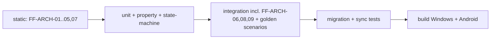

# Architecture Fitness Functions

- Status: Draft (Batch 4). Canonical IDs are `FF-ARCH-01..09`. This doc reconciles the provisional names used in [../architecture/architecture-principles.md](../architecture/architecture-principles.md) (FF-MOD/DEP/DOM/DB/GOV/AI) into the FF-ARCH set, resolving OQ-REPO-2.
- Date: 2026-11-04
- Related: [../architecture/repository-structure.md](../architecture/repository-structure.md) section 5, [../invariants/invariant-catalog.md](../invariants/invariant-catalog.md)

## 1. Name reconciliation (resolves OQ-REPO-2)
| Provisional (Batch 1) | Canonical | Note |
|---|---|---|
| FF-MOD-01 (module boundaries) | FF-ARCH-02 | cross-context published-API only |
| FF-DEP-01 (dependency direction) | FF-ARCH-01 + FF-ARCH-04 | layering/import rules |
| FF-DOM-01 (pure domain) | FF-ARCH-01 | no Flutter/DB in domain |
| FF-DB-01 (table ownership) | FF-ARCH-02 | part of cross-context rule |
| FF-GOV-01 (no write outside handlers) | FF-ARCH-03 | — |
| FF-GOV-02 (authorize before domain) | FF-ARCH-09 (new) | split out as its own check |
| FF-AI-01 (AI not direct DB) | FF-ARCH-01 + FF-ARCH-03 | AI obeys the same import + write rules |

`architecture-principles.md` keeps the provisional names as prose; this table is the mapping. [Proposal] A later docs pass can replace the provisional names inline; not required for correctness.

## 2. Fitness functions
Each: rule, mechanism, CI stage, failure condition, severity, owner.

| ID | Rule | Mechanism | CI stage | Failure condition | Severity | Owner |
|---|---|---|---|---|---|---|
| FF-ARCH-01 | `domain/*`, `time_kernel`, `foundation` import no Flutter, Drift, Supabase or platform SDK | import scan (custom script over package sources) | static-analysis (pre-test) | any forbidden import found | critical | platform |
| FF-ARCH-02 | No context imports another context's internal symbols; only published ports/types | import scan + published-API allowlist | static-analysis | import of a non-allowlisted symbol | critical | platform |
| FF-ARCH-03 | No repository write (save/delete) outside a command handler | call-graph / custom lint over application layer | static-analysis | a write call reachable from non-handler code | critical | platform |
| FF-ARCH-04 | `ui` does not import `infrastructure` or Drift | import scan | static-analysis | forbidden import | high | platform |
| FF-ARCH-05 | No cyclic dependency between packages/contexts | package dependency graph check | static-analysis | a cycle exists | high | platform |
| FF-ARCH-06 | Each mutation command handler writes the atomic set (aggregate+audit+outbox+event+dedupe) in one transaction | **targeted test** (not static) + fault-injection (GS-06/07) | integration test | a handler commits a partial set | critical | governance |
| FF-ARCH-07 | No AGPL or unknown-license dependency in the resolved set | license scan over the dependency tree (ADR-0018) | static-analysis | AGPL/unknown present | critical | platform |
| FF-ARCH-08 | No egress path includes a Restricted item toward cloud AI | **test** over the Context Builder (GS-16) | integration test | a Restricted item reaches a cloud request | critical | privacy |
| FF-ARCH-09 | Every mutation is authorized before the domain method runs | targeted test over the gateway + review | integration test | a mutation path skips authorization | critical | governance |

## 3. Static vs test-based
- FF-ARCH-01/02/03/04/05/07 are **static** (import/graph/license scans) — fast, run on every push.
- FF-ARCH-06/08/09 are **test-based** because they assert runtime behavior (atomic transaction, egress filtering, authorization) that a static scan cannot prove. They tie directly to invariants LF-INV-GOV-003, LF-INV-PRIV-002, LF-INV-GOV-002.

## 4. Tooling note
- Dart import scanning can use `analyzer`/custom scripts; a dependency/license scan can parse `pubspec.lock` + each package's LICENSE (ADR-0018). [Assumption] exact tooling is chosen when CI is set up (Batch 5 / P00 exit); the rules here are tool-agnostic.
- These avoid formal-only checks: each maps to a concrete regression (a forbidden import, a cycle, a partial-commit, a leaked Restricted item, an AGPL dependency, an unauthorized write).

## 5. CI stage order

## 6. Self-check
- [x] Provisional FF names reconciled to FF-ARCH (OQ-REPO-2 resolved).
- [x] Each FF has rule/mechanism/CI stage/failure/severity/owner.
- [x] Behavioral rules are tests, not static checks; each maps to an invariant/regression.
