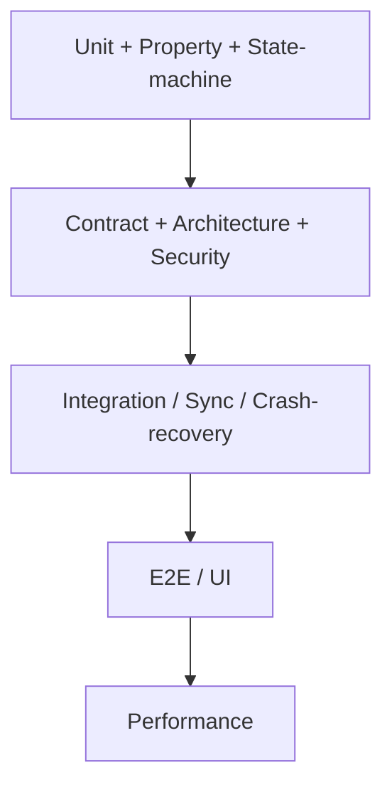

# Test Strategy

- Status: Draft (Batch 4)
- Date: 2026-11-04
- Related: [golden-scenarios.md](golden-scenarios.md), [../invariants/invariant-test-matrix.md](../invariants/invariant-test-matrix.md), [architecture-fitness-functions.md](architecture-fitness-functions.md), [definition-of-done.md](definition-of-done.md)

## 1. Layers and what each verifies

| Layer | Verifies (invariant categories) | Tooling (proposal) |
|---|---|---|
| Unit | pure logic: targets, progress calculators, value objects | `dart test` |
| Property-based | recurrence determinism/no-duplicates, hierarchy acyclicity, review-schedule reproducibility | a Dart property-test approach (generator-based) |
| State-machine | Task status transitions, FocusSession machine | model-based/table tests |
| Integration | command pipeline, habit evaluation, goal progress, health ingestion | `dart test`/`flutter test` with the real Drift DB (in-memory/file) |
| Migration | schema upgrades (Drift guided migrations, VS-04) | Drift migration test harness |
| Contract | cross-context ports (TaskReader, RecordMeasurement, CreateTask) | contract tests over ports |
| Architecture (fitness) | FF-ARCH-01..05,07 static; FF-ARCH-06,08,09 behavioral | custom scripts + integration tests |
| Security | encryption at rest, secrets in secure storage, egress | targeted security tests + `PRAGMA cipher`, log scans |
| Sync | idempotent apply, per-type conflict, tombstones | multi-replica sync harness (P04) |
| Crash/recovery | atomic set, focus recovery, outbox/event not lost | process-kill/fault-injection harness |
| UI | view-model behavior, adaptive layout smoke | `flutter test` + widget tests |
| E2E | key user journeys (MVP use cases) | integration_test driver |
| Performance | NFR targets (section 3) | benchmark harness |

## 2. Invariant-category → primary layer
- Identity/Workspace → integration + architecture (isolation, binding).
- Task/Planning → unit + property (recurrence, hierarchy) + state-machine (status).
- Execution/Measurement → unit + crash/recovery.
- Governance/Transaction → crash/fault-injection + architecture (the atomic-set and version invariants are the highest-value tests).
- Sync → sync harness (P04).
- Security/Privacy → security + egress tests + license scan.
- AI → integration (injection, stale proposal, egress) — P06.

## 3. Performance targets
[Assumption — benchmark needed] These restate the NFR placeholders; actual thresholds are set after benchmarking on a mid-range Android device and a typical Windows laptop (Batch 5 estimation flags the benchmarks).

| Target | Placeholder | Benchmark needed |
|---|---|---|
| Cold start to Today view | ~< 2 s | yes |
| Open 10,000-task list | 60 fps scroll | yes |
| Occurrence generation (month window, 200 rules) | ~< 50 ms | yes |
| Focus timer accuracy after recovery | within 1 s | measured by GS-13 |
| Dictionary lookup latency (offline) | TBD | yes (P07) |
| Sync latency per batch | TBD | yes (P04) |

## 4. Crash/recovery and sync approach
- Crash/recovery: a harness that commits a command, kills the process at injected points, relaunches, and asserts the atomic-set and recovery invariants (GS-06, GS-07, GS-13). Handlers must be idempotent (ADR-0014).
- Sync: a multi-replica harness simulating two profiles/devices with controllable connectivity to exercise per-type conflict, idempotent replay and tombstones (GS-08, GS-12-analogue, GS-14, GS-17). P04.

## 5. CI
- Stage order per [architecture-fitness-functions.md](architecture-fitness-functions.md) section 5: static FFs → unit/property/state-machine → integration (+ behavioral FFs + golden scenarios) → migration/sync → build Windows+Android.
- [Assumption] CI platform chosen at P00 exit (candidate GitHub Actions); the legacy repo had no CI.
- `dart_test` concurrency: unlike the legacy single-DB singleton (which forced `concurrency: 1`), LifeFlow's per-command transactions and test isolation should allow parallel test execution; confirm in P01.

## 6. Test data and determinism
- Time and randomness are injected (a `Clock` port, seeded generators) so recurrence, DST, spaced repetition and IDs are reproducible in tests. UUID v7 generation is behind a port so tests can use deterministic IDs.

## 7. Self-check
- [x] Every brief-listed layer is present and mapped to invariant categories.
- [x] Governance/transaction invariants are verified by crash/fault-injection, the highest-value layer for them.
- [x] Performance targets are labeled Assumption/benchmark-needed, not fabricated thresholds.
